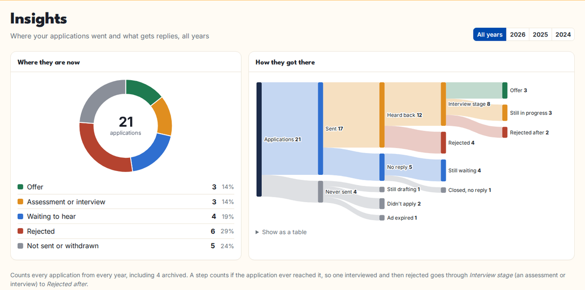
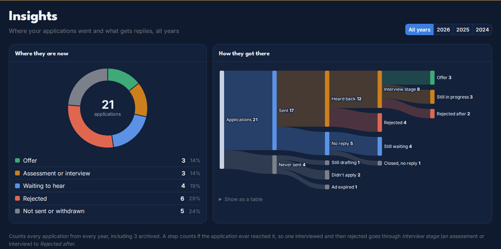
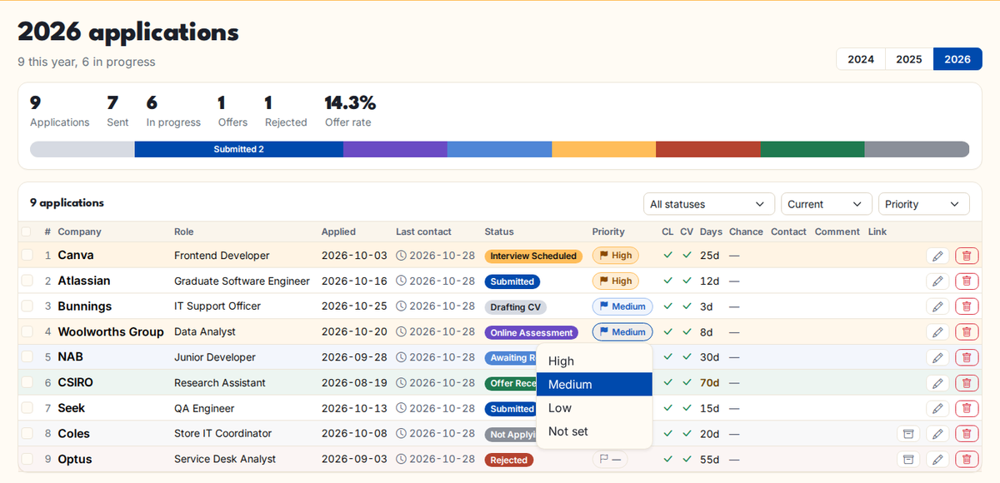
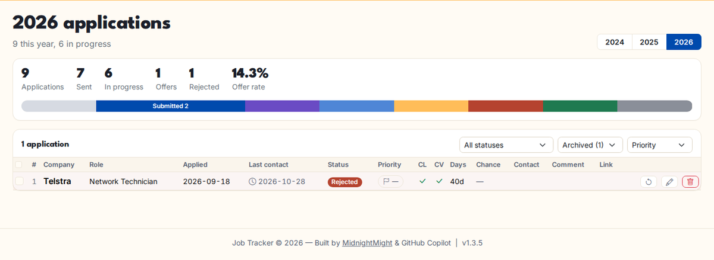

# User Guide — Job Application Tracker

A practical reference for everyday use: adding jobs, tracking progress, using
bulk operations, searching, and exporting your data.

---

## Table of Contents

1. [Dashboard overview](#1-dashboard-overview)
2. [Adding a job application](#2-adding-a-job-application)
3. [Editing and deleting an application](#3-editing-and-deleting-an-application)
4. [Viewing the application detail page](#4-viewing-the-application-detail-page)
5. [Year view and filtering](#5-year-view-and-filtering)
6. [Bulk operations](#6-bulk-operations)
7. [Global search](#7-global-search)
8. [Company tracker](#8-company-tracker)
9. [Custom statuses](#9-custom-statuses)
10. [Reminder inbox](#10-reminder-inbox)
11. [Importing from CSV or Excel](#11-importing-from-csv-or-excel)
12. [Exporting data](#12-exporting-data)
13. [AI assistant (Ollama)](#13-ai-assistant-ollama)
14. [Dark / light theme](#14-dark--light-theme)
15. [Keyboard shortcuts and tips](#15-keyboard-shortcuts-and-tips)
16. [Workforce Australia report](#16-workforce-australia-report)
17. [Next steps and the calendar feed](#17-next-steps-and-the-calendar-feed)
18. [Adding a job from your phone's share menu](#18-adding-a-job-from-your-phones-share-menu)
19. [Saved job ads and attachments](#19-saved-job-ads-and-attachments)
20. [Insights](#20-insights)
21. [Auto-archive](#21-auto-archive)
22. [Priorities](#22-priorities)
23. [Restoring archived applications](#23-restoring-archived-applications)

---

## 1. Dashboard overview

The dashboard is the first page you see at `http://localhost:5000`. It shows a
summary for the current year and charts for all tracked years.

| Card / chart | What it shows |
|---|---|
| **Applications** | All applications in the current year |
| **Sent to employers** | Applications past Drafting_CV / Select_Status / Not_Applying |
| **Offers** | Applications with status Offer_Received |
| **Offer rate** | Offers ÷ sent × 100 |
| **Coming up** | Next steps due in the next two weeks, and any overdue ones (see [section 17](#17-next-steps-and-the-calendar-feed)). Hidden when there are none |
| **Where they are now** | A honeycomb with one cell per status and its count this year, in your status order. Click a cell to open that year's list filtered to the status |
| **Applications per year** | Bar chart comparing annual totals |
| **Offer rate per year** | Line chart of yearly offer rates |
| **Top keywords** | Most common company notes / sectors |
| **In progress** | Table of applications still being drafted, submitted or interviewing |

---

## 2. Adding a job application

1. Click **Add application** in the top bar (the amber **+** button on a phone).
2. Fill in the form:

| Field | Required | Description |
|---|---|---|
| **Company** | ✅ | Employer name |
| **Date Applied** | ✅ | Date you submitted (or intend to submit). Click **Today** to autofill. |
| **Job Title / Role** | — | Position title |
| **Team** | — | Department or team name |
| **Status** | — | Current stage (defaults to `Select_Status`) |
| **Cover Letter** | — | Tick if you included a cover letter |
| **Resume / CV** | — | Tick if you sent a CV (ticked by default) |
| **Link** | — | URL to the job posting |
| **Contact** | — | Known contact or connection (e.g. a referral) |
| **How Applied** | — | Online (job board), company website, email, in person, phone, recruitment agency or other — used by the Workforce Australia report |
| **Employer Contact** | — | Who you applied to: name, phone or email — used by the Workforce Australia report |
| **Success Chance** | — | Your personal estimate (0–1 or percentage) |
| **Comment** | — | Short note about the application |
| **Additional Notes** | — | Longer free-text notes |
| **Next step** / **Next step date** | — | What happens next and when (follow up, interview, assessment due) — see [section 17](#17-next-steps-and-the-calendar-feed) |
| **Job ad (saved copy)** | — | The ad text, kept after the listing comes down. AI fill saves the pasted ad here |

3. Click **Save Application**. The application is added to the year matching
   **Date Applied**.

> **Tip:** If you leave a required field blank, a validation modal highlights
> the missing field rather than silently failing.

**Possible duplicates.** Before saving, the tracker checks whether you already
have the same company and role (and team) with a date applied within 60 days,
or any application with the same job ad link — including archived ones. If so
it lists them with their status; click **Add Anyway** to save regardless (for
example, a re-advertised role).

---

## 3. Editing and deleting an application

**Edit:** Click the **pencil icon** on any row in a year view, or click
**Edit** on the detail page.

**Delete:** Click the **bin icon** on any row. A confirmation prompt appears.
Deletion also removes the status timeline history for that application.

---

## 4. Viewing the application detail page

Click the **company name** or the **eye icon** on any row to open the detail page.

The detail page shows:

- All fields including additional notes and contact
- **Status timeline** — every status change with the date/time and how many
  days elapsed between each stage. The dots are colour-coded to match the status
  badge colours.
- **Quick-edit status** button to update the current stage directly

---

## 5. Year view and filtering

Click **By Year** in the navigation bar and choose a year to see all
applications for that year in a table.

**Filter by status:**

1. Use the **Filter by Status** dropdown above the table.
2. Click **Apply** to show only applications with that status.
3. Click **Clear** to remove the filter.

**Columns in the table:**

| Column | Description |
|---|---|
| **Company** | Employer name (links to detail page) |
| **Role / Team** | Job title and team |
| **Applied** | Date applied |
| **Last Contact** | Last contact date (🔵 icon) or last status change (⏰ icon) |
| **Status** | Colour-coded status badge |
| **Priority** | High / Medium / Low flag; click it to change (see [Priorities](#22-priorities)) |
| **CL** | Cover letter ✔ / ✘ |
| **CV** | Resume ✔ / ✘ |
| **Days** | Days since application date (yellow > 60 days, grey > 120 days) |
| **Chance** | Success chance estimate |
| **Contact** | Recruiter / contact name |
| **Comment** | Short note (truncated) |
| **Link** | External job posting link |

**Sort:** *Priority* (the default) puts the jobs that need you first — see
[Priorities](#22-priorities). *Newest first* and *By status* are still there.

**Show:** *Current* hides archived applications; switch to *Archived (n)* to
see and restore them.

---

## 6. Bulk operations

The bulk-action toolbar above the applications table lets you update or delete
multiple rows at once — useful for post-rejection cleanup.

### Selecting rows

| Method | How |
|---|---|
| Tick individual rows | Click the checkbox at the left of each row |
| Select all | Click **All** in the toolbar, or tick the header checkbox |
| Deselect all | Click **None** in the toolbar |

The **N selected** counter updates in real time.

### Available bulk actions

| Action | How to use |
|---|---|
| **Set Status** | Choose a status from the dropdown, click **Set** |
| **Set Priority** | Choose High, Medium, Low or Not set, click **Set** |
| **Set Date Applied** | Pick a date, click **Set** |
| **Set Last Contact** | Pick a date, click **Set** |
| **Set Cover Letter** | Choose Yes/No, click **Set** |
| **Set Resume** | Choose Yes/No, click **Set** |
| **Delete Selected** | Click **Delete Selected** — a confirmation prompt appears |

> **Tip:** To mark all rejections in one go — filter the year view to
> `Submitted` or `Awaiting_Response`, select all, choose `Rejected` from the
> status dropdown, click **Set**.

---

## 7. Global search

The **search bar** in the navigation bar (🔍 icon) searches across *all years*
at once.

Searches these fields:
- Company name
- Job title / role
- Team
- Comment
- Additional notes
- Contact

**To search:**

1. Type a keyword into the search box in the navbar and press **Enter**, or
   go to `/search` directly.
2. Results show the company, role, year, status, and a snippet of the comment /
   notes.
3. Click the company name or **eye icon** to open the detail page.
4. Click the year link to jump to the year view for that application.

> **Minimum query length:** 2 characters.

---

## 8. Company tracker

Go to **Companies** in the navigation bar to see a table of all companies with:

- Notes / sector
- Applied columns for each tracked year (2023–2027)

**Add a company:** Click **Add Company** and fill in the name and optional note.

**Edit / delete:** Use the icons on the right of each row.

When **Company List Pooling** is enabled (Settings → General), all users share
the company list but private notes from other users are hidden.

---

## 9. Custom statuses

Go to **Settings → Statuses** to manage your status list.

- **Add:** Type a name in the input field and click **Add Status**. Spaces are
  automatically converted to underscores.
- **Delete:** Click the bin icon next to a status. Deletion is blocked while
  any application uses that status — update those applications first.

**Default statuses:**

| Status | Meaning |
|---|---|
| `Select_Status` | Placeholder — not yet categorised |
| `Drafting_CV` | Preparing application materials |
| `Submitted` | Application submitted |
| `Online_Assessment` | Online test or coding challenge |
| `Awaiting_Response` | Waiting to hear back |
| `Interview_Scheduled` | Interview confirmed |
| `Interview_In_Person` | In-person interview stage |
| `Offer_Received` | Offer received 🎉 |
| `Offer_Rejected` | Offer declined |
| `Rejected` | Application unsuccessful |
| `Likely_Rejected` | No response for a long time |
| `Not_Applying` | Decided not to proceed |
| `EOI` | Expression of interest |

---

## 10. Reminder inbox

The **bell icon** in the top bar shows an amber badge with the number of unread
reminders. Click it to open the inbox.

A reminder is automatically created when an application has been in a pending
status (e.g. `Submitted`, `Awaiting_Response`) for longer than the configured
threshold (default: **3 days**).

**Configure reminders:**

1. Go to **Settings → General**.
2. Toggle **Enable reminder notifications** on or off.
3. Change the **Reminder threshold (days)** — must be ≥ 1.
4. Click **Save**.

**Dismiss reminders:**

- Click **Dismiss** next to a single reminder.
- Click **Dismiss All** at the top to clear everything at once.

---

## 11. Importing from CSV or Excel

1. Open the menu (the person or **⋯** button at the top right) and click **Import CSV**.
2. **Step 1 — Upload:** Select a `.csv` or `.xlsx` file. The first row must be
   column headers (any header names are fine).
3. **Step 2 — Map Columns:** Assign each detected column to an application
   field using the dropdowns. Auto-guessing fills in common column names.
   A preview of the first five rows helps you confirm the mapping.
4. Optionally tick **Update existing applications** (see below).
5. Click **Import Applications**.

**Required per row:** a `company` or a `job_desc` (role). `date_applied` is
optional — undated rows are imported as undated.

**Accepted date formats:** `YYYY-MM-DD`, `DD/MM/YYYY`, `DD-MM-YYYY`,
`MM/DD/YYYY`, `YYYY/MM/DD`, and ISO timestamps such as `2026-10-26T09:30:00`.
`job_expiry_date` can be imported too.

**Yes/no columns** (`cover_letter`, `resume`) accept `1/0`, `yes/no`,
`true/false`, `y/n` or `x`.

**Editing in a spreadsheet (update mode):** export your applications
(**Export → Applications CSV**), edit the file, then re-import it with
**Update existing applications** ticked.  Rows whose `id` matches one of your
applications — or whose company + role + team + date match — update that
application instead of being added again.  Only the columns you map are
changed, and status changes are recorded in the timeline.  Without the tick,
exact duplicates are skipped as before.

The results page shows rows added, updated and skipped, the reason for any
skipped rows, and any values that were corrected (for example an unreadable
date or an unknown status, which falls back to `Select_Status`).

---

## 12. Exporting data

Go to **Export** in the navigation bar.

| Export | Format | Filters |
|---|---|---|
| Applications | CSV | Year, status, company name |
| Workforce Australia report | CSV | One fortnight (see [section 16](#16-workforce-australia-report)) |
| Company list | CSV | — |
| Full database | SQLite `.db` | — |

**To migrate to a new device:** Download the full database, copy it to the new
installation folder, rename it `jobs.db`, and restart the app.

---

## 13. AI assistant (Ollama)

> Available in Docker / server mode only.

The AI assistant uses a locally running [Ollama](https://ollama.com) server —
your data never leaves your machine.

### Setup

1. Install Ollama from [ollama.com](https://ollama.com).
2. Pull a model: `ollama pull llama3` (or `mistral`, `phi3`, etc.)
3. Go to **Settings → AI Assistant**.
4. Enable **Ollama AI Assistant**, set the server URL and model name.
5. Click **Test** to verify the connection, then **Save AI Settings**.

### Using AI Fill

On the **Add / Edit Application** form, paste a job description into the
**Job Description** field and click **AI Fill**. The assistant extracts and
fills in the role, company, and team fields automatically.

### Smart Job Fit Analysis

Enable **Smart Job Fit Analysis** in Settings → AI Assistant. Once enabled:

1. Fill in your profile (Skills, Experience, Summary) on the same page — or
   upload your CV/résumé as a PDF to extract the text automatically.
2. After AI Fill runs, the app compares the job requirements against your
   profile and shows a match score, skill gaps, and a recommendation.

---

## 14. Dark / light theme

The app follows your device's light or dark setting until you choose one
yourself. To switch, open the menu (the person or **⋯** button at the top right)
and click **Dark theme** or **Light theme**. Your choice is saved in your
browser.

---

## 15. Keyboard shortcuts and tips

| Tip | How |
|---|---|
| **Today button** | On any date field, click the **Today** button to fill today's date without opening the calendar |
| **Quick search** | Press **/** or click the search box in the top bar to jump straight to global search |
| **Bulk reject** | Year view → filter by `Awaiting_Response` → select all → set status to `Rejected` → Set |
| **Jump to year** | Use **Applications** in the top bar, or the year buttons at the top of a year view |
| **Offline access (PWA)** | On a server / Docker deployment, add the app to your home screen for fast access and cached offline pages |

---

## 16. Workforce Australia report

**Report** in the navigation bar lists the applications you applied for in one
fortnight, ready to report as job search efforts.

- **Your reporting period.**  Enter the start date of any of your Workforce
  Australia reporting periods under *My reporting period starts on* and click
  **Save**.  The report then always opens on your current fortnight; the
  arrows step back and forward a fortnight at a time.  Until you save one,
  fortnights start on this week's Monday.  Each user has their own date.
- **What is listed.**  Every application whose **Date Applied** falls in the
  fortnight (first and last day included), archived ones too.  Undated
  applications are not listed.
- **Missing details.**  Rows without **How Applied** or **Employer Contact**
  are highlighted, with an **Add details** button that opens the application.
- **Copy** on a row copies that application as labelled lines (Date applied,
  Job title, Employer, How applied, Employer contact, …) to paste into the
  Workforce Australia site or app, an email, or a note.
- **Copy all** copies the whole table as tab-separated text, which pastes into
  a spreadsheet as columns.
- **Download CSV** saves the fortnight as
  `workforce-report_<start>_to_<end>.csv` (dates as DD/MM/YYYY).

Copying works over plain `http://` too (e.g. a NAS address), where browsers
block the newer clipboard API.

> The report helps you keep and copy your records; it does not send anything
> to Workforce Australia.  Check their site or your provider for what you must
> report and by when.

---

## 17. Next steps and the calendar feed

Give an application a **Next step** and **Next step date** on its form — for
example "Phone interview" on the 5th, or "Follow up" in a week. Then:

- the dashboard's **Coming up** list shows it for the two weeks before it's
  due, and marks it **Today** or **overdue**;
- the inbox gets a reminder on the day it's due (once per date; change the
  date and you'll get a new one when the new date arrives). This follows the
  **Enable reminder notifications** switch in Settings;
- it appears in your calendar if you've set up the feed.

**Calendar feed.** In **Settings → General → Calendar feed**, click **Make a
calendar link**, then add the link to your calendar app as a subscription
(**Subscribe on this device** does this on iPhone, iPad and Mac; in Google
Calendar use *Other calendars → From URL*). Every next step shows as an
all-day event and updates on its own. Calendar apps can't log in, so the link
holds a private code: anyone with it can see those events. **New link**
replaces it (the old one stops working) and **Turn off** removes it. The
calendar app has to be able to reach the tracker, so it updates only on your
home network unless the tracker is reachable from outside.

## 18. Adding a job from your phone's share menu

Install the tracker on your phone's home screen (Chrome menu → *Add to Home
screen* / *Install app*). Then, on a job ad in SEEK, LinkedIn or a browser,
tap **Share → Job Tracker**: the Add form opens with the link filled in (and
the role, when the sharing app sends a title). Paste the ad into **AI fill**
or fill in the rest. If that link is already saved, you're told which
application has it.

This uses the Web Share Target feature, which works on Android (Chrome, Edge,
Samsung Internet). iPhones don't offer installed web apps in the share menu —
copy the link and use **Add application** instead. Installing the app needs
the tracker to be opened over `https://` (or on the device itself).

## 19. Saved job ads and attachments

- **Job ad (saved copy)** on the form keeps the ad text with the application,
  so you can reread it before an interview after the listing has gone. When
  you use AI fill, the pasted ad is saved here automatically. The detail page
  shows it under **Job ad (saved copy)** — click **Show**.
- **What you sent** on the detail page holds the exact CV, cover letter or
  other files you sent (PDF, Word, ODT, RTF or text, up to 10 MB each). Click a
  file to download it, × to remove it. Files are stored in an `attachments`
  folder next to the database (`/data/attachments` in Docker) and are deleted
  with their application. The **Full database** download does not include
  them — back up the whole data folder to keep them.

## 20. Insights

**Insights** in the top bar shows where your applications went and what gets
replies, for **All years** (every past year together) or one year. Archived
applications are always included.

**Where they are now** is a doughnut of every application by its current
status, grouped into Offer, Assessment or interview, Waiting to hear, Rejected,
and Not sent or withdrawn. The list under it gives the numbers and percentages.

**How they got there** follows every application step by step, left to right:

1. **Applications** splits into **Sent** and **Never sent**.
2. *Never sent* splits into **Still drafting**, **Didn't apply** and **Ad expired**.
3. *Sent* splits into **Heard back** and **No reply**; no reply is either
   **Still waiting** or **Closed, no reply** (the ad expired or you marked it
   likely rejected).
4. *Heard back* is either **Interview stage** (an online assessment or
   interview) or **Rejected** straight away.
5. *Interview stage* ends in **Offer**, **Still in progress**, **Rejected after**
   or **Ended another way** (for example you withdrew).

The width of each band is the number of applications. Hover over a band or
bar for its count, or open **Show as a table** for the same numbers as a list.
A step counts if the application ever reached it, so update statuses as things
happen rather than jumping straight to the final one.

Both charts follow the light or dark theme:

Below the charts, response rates look only at applications sent to employers
(Submitted or later):

| Measure | Meaning |
|---|---|
| **Heard back** | Reached an assessment, interview, offer or rejection at any point |
| **Assessment or interview** | Reached an online assessment, interview or offer at any point |
| **Typical reply** | Median days from applying to the first reply, counted from when you changed the status in the tracker. Applications added already at interview or rejected are left out of this one |

Results are broken down **by how you applied** and **by industry** (each tag
counts separately). Groups with fewer than 5 applications are marked *few* —
treat those percentages with care. Statuses you've added yourself count as
sent, not as a reply.

## 21. Auto-archive

In **Settings → General**, set **Auto-archive finished applications** to a
number of days to have Rejected, Not Applying and Job Expired applications
archived automatically that many days after their last status change (checked
once a day). **0**, the default, turns it off. Archived applications leave the
year view but still count in Insights and the Workforce Australia report.

## 22. Priorities

Give each application a priority — **High**, **Medium** or **Low** — to decide
which jobs to put your time into first.

- **Set it** on the add/edit form (next to *Next step*), by clicking the flag
  in the **Priority** column of the year view, or for many at once with
  **Priority → Set** in the bulk-edit bar.
- **Priority sort** is the year view's default order: applications still in
  progress first, then High → Medium → Low → not set, then the soonest next
  step, then the newest. Finished ones (Rejected, Not Applying, Job Expired)
  go to the bottom whatever their priority.
- Priority is shown on the application page and included in CSV export and
  import (*High/Medium/Low* or *3/2/1*, blank or *0* for not set).

## 23. Restoring archived applications

Archived applications are hidden from the year view and dashboard, not
deleted. To bring one back, use **Restore**
(<i>↺</i>) in any of these places:

- the application's own page (an *Archived on …* note shows at the top),
- the **Archived** list on its company page,
- the year view with **Show → Archived (n)**.

If auto-archive is on, a restored application isn't archived again until the
auto-archive period has passed since you restored it.

